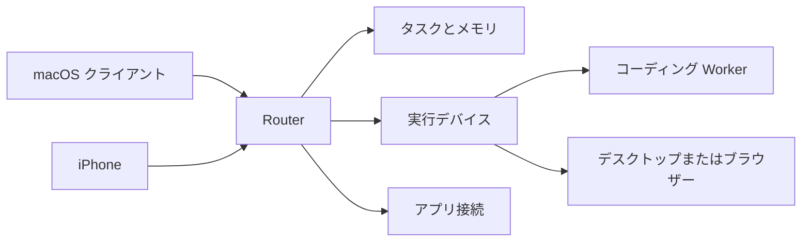

# Blazar

[English](README.md) · [简体中文](README.zh-CN.md) · [日本語](README.ja.md)

Blazar はローカルファーストのエージェント調整ツールです。Mac や iPhone から作業を依頼すると、Router がタスクとコンテキストを管理し、適切なデバイスに処理を割り当て、承認依頼と結果をクライアントに返します。

## 主な機能

- **タスクの進行管理。** 依存関係のあるステップ、手動確認、成果物の引き継ぎ、タスクの復旧に対応します。
- **コーディングエージェントの実行。** Codex、Pi、DeepSeek Harness、Kimi Code、OpenCode などを指定したワークスペースで実行できます。ACP や JSONL で独自の Worker も追加できます。
- **承認付きのコンピューター操作。** ウィンドウの観察と撮影、設定済みボタンのクリック、許可されたテキスト欄の編集ができます。結果を確認してから後続ステップに進むよう設定できます。
- **アプリを横断したコンテキストの利用。** 複数のアカウントを接続し、許可された情報を検索できます。書き込みの承認と、結果が不明な操作の照合にも対応します。
- **iPhone からの確認。** デスクトップでペアリングすると、Router 経由でタスクの進捗、承認依頼、成果物を確認できます。

## クイックスタート

Node.js 22.19 以上が必要です。

```sh
git clone https://github.com/CL-lau/Blazar.git
cd Blazar
npm ci
export BLAZAR_ROUTER_TOKEN="$(node -e 'process.stdout.write(require("node:crypto").randomBytes(32).toString("hex"))')"
npm run router
```

別のターミナルで `npm run desktop` を実行し、最初のターミナルで生成した Router トークンで接続します。実行デバイスを登録すると、指定したワークスペースでタスクを実行できます。既定のデバイスではローカルのテキストファイルをプレビューできます。登録、Worker の選択、権限の設定は[設定と運用ガイド](docs/setup.md)を参照してください。

## 構成



## ドキュメント

| ガイド | 内容 |
| --- | --- |
| [設定と運用（英語）](docs/setup.md) | ビルド、デバイス登録、Worker、アプリ接続、バックアップ、リモートアクセス |
| [製品設計（簡体字中国語）](docs/blazar-design.md) | アーキテクチャ、権限、タスクのライフサイクル、検証 |
| [GitHub Actions](https://github.com/CL-lau/Blazar/actions) | Router、macOS、iOS のビルドとテスト結果 |

## 開発状況

コア機能は `main` にあります。一部の Worker はローカルのモックモデルで検証しています。iPhone 実機と APNs 配信、権限を付与した macOS の操作、別ホスト間のデプロイは実環境での検証が残っています。IM 連携は今回の対象外です。

ドキュメント構成は [Linger](https://github.com/simplexai-labs/linger) を参考にしています。
