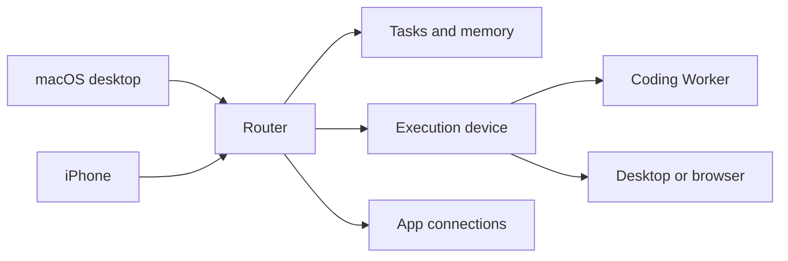

# Blazar

[English](README.md) · [简体中文](README.zh-CN.md) · [日本語](README.ja.md)

Blazar is a local-first agent coordinator. Give Blazar a goal from your Mac or iPhone. The Router keeps the task and its context, sends work to the right device, and brings approvals and results back to you.

## What Blazar can do

- **Coordinate work** across steps with dependencies, explicit review, reusable artifacts, and recoverable task state.
- **Run coding agents** such as Codex, Pi, DeepSeek Harness, Kimi Code, and OpenCode in a configured workspace. Add your own Worker using ACP or JSONL.
- **Operate a computer with approval.** Inspect a window, capture a screenshot, click a configured button, or edit an allowed text field. Workflow steps can require verified results before they advance.
- **Use context across apps.** Connect multiple accounts, retrieve authorized sources, and review application writes before dispatch. The Router tracks uncertain results for reconciliation.
- **Stay connected from iPhone.** Pair from the desktop, review approvals, inspect artifacts, and follow tasks through the Router.

## Quick start

Requires Node.js 22.19 or later.

```sh
git clone https://github.com/CL-lau/Blazar.git
cd Blazar
npm ci
export BLAZAR_ROUTER_TOKEN="$(node -e 'process.stdout.write(require("node:crypto").randomBytes(32).toString("hex"))')"
npm run router
```

In a second terminal, run `npm run desktop` and connect with the Router token from the first terminal. Register an execution device to run tasks in a workspace. The default device can preview local text files. See [setup and operations](docs/setup.md) for registration, Worker selection, and permissions.

## How it fits together



## Documentation

| Guide | Contents |
| --- | --- |
| [Setup and operations](docs/setup.md) | Native builds, device setup, Worker presets, application connections, backups, and remote access |
| [Product design (简体中文)](docs/blazar-design.md) | Architecture, permissions, lifecycle, and verification |
| [GitHub Actions](https://github.com/CL-lau/Blazar/actions) | Router, macOS, and iOS build and test results |

## Project status

The core implementation is on `main`. Several Worker integrations are verified with local mock endpoints. Physical iPhone and APNs delivery, macOS computer control with system permissions, and cross-host deployment still need end-to-end verification. IM integration is outside the current delivery scope.

The project documentation takes inspiration from [Linger](https://github.com/simplexai-labs/linger).
