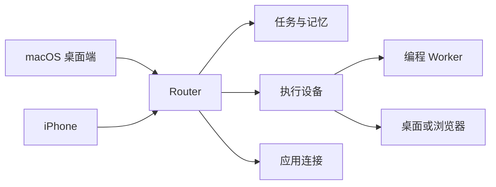

# Blazar

[English](README.md) · [简体中文](README.zh-CN.md) · [日本語](README.ja.md)

Blazar 是一个本地优先的 Agent 协调器。你可以从 Mac 或 iPhone 向 Blazar 提出目标，由 Router 保存任务和上下文、派发执行，并把审批和结果带回客户端。

## 核心能力

- **编排任务。** 支持有依赖的步骤、人工验收、产物交接和任务恢复。
- **运行编程 Agent。** 在指定工作区使用 Codex、Pi、DeepSeek Harness、Kimi Code 和 OpenCode 等 Worker，也可通过 ACP 或 JSONL 添加自定义 Worker。
- **经审批操作电脑。** 可以观察窗口、截图、点击已配置的按钮或编辑允许的文本字段。工作流可在核验结果后再推进后续步骤。
- **跨应用使用上下文。** 支持连接多个应用账号、检索已授权资料、审批应用写入，并对结果不确定的操作进行对账。
- **从 iPhone 跟进。** 在桌面端配对后，可通过 Router 查看任务和产物并处理审批。

## 快速开始

需要 Node.js 22.19 或更高版本。

```sh
git clone https://github.com/CL-lau/Blazar.git
cd Blazar
npm ci
export BLAZAR_ROUTER_TOKEN="$(node -e 'process.stdout.write(require("node:crypto").randomBytes(32).toString("hex"))')"
npm run router
```

在另一个终端执行 `npm run desktop`，用第一个终端生成的 Router 令牌连接。注册执行设备后，即可在指定工作区运行任务。默认设备支持预览本地文本文件。设备注册、Worker 选型和权限配置见[配置与运维指南](docs/setup.md)。

## 架构



## 文档

| 指南 | 内容 |
| --- | --- |
| [配置与运维（英文）](docs/setup.md) | 原生构建、设备注册、Worker、应用接入、备份和远程访问 |
| [产品设计](docs/blazar-design.md) | 架构、权限、任务生命周期和验收 |
| [GitHub Actions](https://github.com/CL-lau/Blazar/actions) | Router、macOS 和 iOS 的构建与测试结果 |

## 当前状态

核心实现已在 `main`。部分 Worker 使用本地模拟模型验证。iPhone 真机和 APNs 投递、授权后的 macOS 电脑操作、跨主机部署仍需端到端验收。IM 接入暂缓。

项目文档结构参考了 [Linger](https://github.com/simplexai-labs/linger)。
