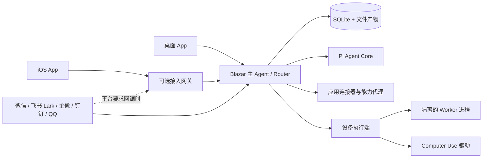

# Blazar 完整产品与技术设计

状态：设计提案。范围覆盖桌面端、iOS、五类 IM、异构 Worker 和团队协作。实际平台账号、Worker 版本和性能指标以验收结果为准。

本期交付聚焦 Blazar 本体，包括桌面与 iOS、Router 上下文与任务管理、Worker 及其扩展、应用连接与跨应用记忆、Computer Use。IM 接入、真实账号联调及依赖 IM 的跨端验收延期。以下渠道设计与已有验证记录保留，供后续恢复接入时使用。

## 1. 产品边界

**Blazar 是产品名，也是唯一面向用户的主 Agent 名。** 桌面、iPhone 和所有 IM 中都以 Blazar 的身份交互。本文的 Router 专指主 Agent 所在的服务和调度职责。Blazar 的核心是上下文与跨应用记忆、持续任务管理，以及直接使用应用和操作电脑。用户提交目标、澄清需求、批准动作、查看进度、取消任务和验收产物。所有交互经过同一个逻辑 Router。Router 选择电脑、工作区和 Worker，决定是否并行、交接或恢复任务。用户只在配置页面管理 Agent 的可用性、凭据和工作区权限。任务历史可以展示执行记录供排障。

桌面端用 Tauri + React，Router 与设备执行端用 TypeScript / Node.js，Rust 宿主负责桌面集成，iOS 用 SwiftUI。桌面端、iOS 与 IM 共享同一会话及任务状态。iPhone 上的远程操作经 Router 派发到电脑，产品界面围绕任务和相关文件、diff、审批、结果设计。IM 范围为微信、飞书 / Lark、企业微信、钉钉、QQ。

## 2. LobeHub 源码研究与取舍

分析快照为 [LobeHub 1b89933](https://github.com/lobehub/lobehub/tree/1b89933c8efc0282078a333ccc6107ddcfb06572)。以下是对实际源码边界的归纳。

| 源码观察 | Blazar 决策 |
| --- | --- |
| `packages/agent-runtime/src/loop/index.ts` 的 `runAgentLoop` 注入 step，支持外部步数限制、每步完成回调和终止判断。运行时、Host、上下文和服务端传输是独立层级。 | 保留「模型循环与副作用分离」的边界。让 Router 的模型只产出决策，SQLite 事务执行状态变更。 |
| `apps/server/src/modules/AgentRuntime/AgentRuntimeCoordinator.ts` 分别注入状态和流管理器。人为审批结束当前事件流，后续以新 operation 恢复。异步工具暂停则保留原 operation。 | 分设 Task、Run、Approval。客户端只订阅一个带游标的 Router 流，暂停和恢复靠持久化任务事件表达。 |
| `packages/heterogeneous-agents/src/registry.ts` 的工厂既有专用 Codex、Claude Code、Pi、Cursor、OpenCode 适配器，也有 Copilot、Droid 等 ACP 适配器。DeepSeek Harness 接在运行时注册表中。 | 共用 ACP 传输与事件归一化，专用协议用独立适配器。注册表保存探测、安装条件、能力、可用版本和认证指引。 |
| `apps/server/src/services/bot/BotMessageRouter/` 处理账号、访问门禁、触发判定和延迟消息重放。`AgentBridgeService` 区分本地与队列执行，附件提取交给平台 client。 | IM adapter 专注收发和平台语义，权限、去重、任务关联和执行全由 Router 处理。 |
| `packages/chat-adapter-{wechat,wecom,feishu,dingtalk,qq}` 加上服务端 `platforms` 目录覆盖目标渠道。飞书和 Lark 有独立 definition，QQ 有被动回复约束，企微有连接与媒体逻辑。 | 复用这些边界设计，按官方接入方式独立实现和验收。每个平台声明自己的回复窗口、附件和主动通知能力。 |
| `packages/device-gateway-client/src/{client,wsTunnel}.ts` 处理设备重连、隧道和流量水位；`agent-gateway-client` 处理运行流回放与终止对账。桌面壳使用 Electron。 | 用窄的设备任务协议和统一重放机制。桌面沿用 Tauri，Rust 壳调用独立 Router 服务。 |

涉及的源码入口：[Agent Loop](https://github.com/lobehub/lobehub/blob/1b89933c8efc0282078a333ccc6107ddcfb06572/packages/agent-runtime/src/loop/index.ts) · [Coordinator](https://github.com/lobehub/lobehub/blob/1b89933c8efc0282078a333ccc6107ddcfb06572/apps/server/src/modules/AgentRuntime/AgentRuntimeCoordinator.ts) · [Worker 注册表](https://github.com/lobehub/lobehub/blob/1b89933c8efc0282078a333ccc6107ddcfb06572/packages/heterogeneous-agents/src/registry.ts) · [Bot 路由](https://github.com/lobehub/lobehub/tree/1b89933c8efc0282078a333ccc6107ddcfb06572/apps/server/src/services/bot) · [设备连接](https://github.com/lobehub/lobehub/tree/1b89933c8efc0282078a333ccc6107ddcfb06572/packages/device-gateway-client)

**策略是参考 LobeHub 的工程边界，保持 Blazar 的依赖图独立。** LobeHub 根许可证对衍生作品的商业分发有附加条件。个别包有独立许可证声明，例如私有 workspace 包 `@lobechat/agent-runtime` 在 manifest 标记 MIT，但还依赖同仓库的上下文与类型包。本文的实现方案采用独立代码。 [根许可证](https://github.com/lobehub/lobehub/blob/1b89933c8efc0282078a333ccc6107ddcfb06572/LICENSE) · [Runtime manifest](https://github.com/lobehub/lobehub/blob/1b89933c8efc0282078a333ccc6107ddcfb06572/packages/agent-runtime/package.json)

### Linger 作为实现基础

采用 [Linger 77abdcb](https://github.com/simplexai-labs/linger/tree/77abdcb37f779f9c9d2de89fa245efa88d3f6584) 的应用架构作为 Blazar 的实现基础。Linger 的 Room / Work Item 对应 Blazar 的会话与任务，TeamHub 作为唯一持久化业务状态入口的模式对应 Router。Computer Daemon 中的出站连接、设备事件账本与运行时适配器对应 Blazar 的设备服务。Linger 将原始应用记录与经模型提出、再经校验的 Wiki 更新分开，Blazar 据此区分证据、派生记忆和用户确认。 [Linger 架构](https://github.com/simplexai-labs/linger/blob/77abdcb37f779f9c9d2de89fa245efa88d3f6584/docs/architecture.md) · [Wiki 与记忆](https://github.com/simplexai-labs/linger/blob/77abdcb37f779f9c9d2de89fa245efa88d3f6584/docs/wiki-and-memory.md)

| Linger 基础 | Blazar 实现与扩展 |
| --- | --- |
| Room / Work Item / Context | 一个 Blazar 主 Agent，多入口会话，持久化任务与运行版本；Router 的状态服务沿用现有 TypeScript / SQLite 实现。 |
| Computer Daemon 的出站 WebSocket、账本和进程适配 | 按设备权限发出任务租约与动作，并按设备序号回放。加入完整 Worker 清单、自定义适配器、iOS 和国内 IM。 |
| Agent workspace、只读 Memory / Wiki、应用命令权限 | 保留工作区隔离和服务端权限校验，引入连接账号级的来源追踪、撤权失效和跨渠道目的端授权。 |

Linger 根许可证对第三方托管和前端标识修改有附加条款。本仓库以独立实现其架构和行为为基础，便于使用 Blazar 的产品标识和发布方式。 [Linger 许可证](https://github.com/simplexai-labs/linger/blob/77abdcb37f779f9c9d2de89fa245efa88d3f6584/LICENSE)

## 3. Router harness 选型

**选择 Pi Agent Core，作为固定版本的库嵌入 Router，并在自己的代码中写一层薄适配。** Pi 源码快照 `cb1205e4661723c7a8c9fb01acd38b7691f97797` 中，`@earendil-works/pi-agent-core` 声明了可注入的 `streamFn`、上下文变换、工具调用前后钩子、终止信号与 steering。可以仅注入少量 Router 工具和受控的上下文。Pi Worker 使用独立的 Coding Agent RPC，会有不同的进程、权限、会话和版本约束。 [Pi Agent 源码](https://github.com/earendil-works/pi-mono/blob/cb1205e4661723c7a8c9fb01acd38b7691f97797/packages/agent/src/agent.ts) · [Pi 集成方式](https://pi.dev/)

| 方案 | 评价 |
| --- | --- |
| Pi Agent Core | TypeScript 可直接嵌入，注入模型传输与工具的切入点明确。Blazar 负责自己的事件、状态和恢复。 |
| Pi Durable | 已经有持久化对话、任务图与恢复能力。当前文档标记 API 为实验性，直接采用会让任务与审批依赖额外一套持久化语义。作为设计参照。 |
| LobeHub Runtime | Loop 层清晰且经过复杂场景使用。运行时和服务逻辑依赖仓库类型、上下文及 Host 传输，移植成本高。 |
| DeepSeek Harness | 架构思路贴近目标。有 `sdk-minimal` 可供嵌入，也有 `acp` 供外部调用。源码以 Cordis profile 组装插件、服务和包，嵌入仍需要适配 profile 的启动和服务依赖。Blazar 用 Pi Core 承载推理循环，应用与设备工具由自己的能力层提供。Worker 通过 `dsh --profile acp` 接入。 |
| 直接模型 SDK | 对单次结构化分类足够，可用于确定性路由后的轻量判定。如果还要支持有界检索与动态上下文，就需要维护自己的循环。 |

[Pi Durable](https://github.com/earendil-works/pi-mono/blob/cb1205e4661723c7a8c9fb01acd38b7691f97797/packages/durable/README.md) · [DeepSeek Harness 架构](https://github.com/deepseek-ai/deepseek-harness/blob/2e39e70496aa02986ca6a820c5d497e816b69d7e/docs/architecture.md) · [DeepSeek CLI profiles](https://github.com/deepseek-ai/deepseek-harness/blob/2e39e70496aa02986ca6a820c5d497e816b69d7e/apps/cli/README.md)

### Harness 接入合同

```ts
interface RouterHarness {
  decide(input: DecisionInput, signal: AbortSignal): Promise<RouterDecision>;
}

type RouterDecision =
  | { kind: 'reply'; text: string }
  | { kind: 'clarify'; question: string }
  | { kind: 'create_task'; goal: string; workspaceHint?: string }
  | { kind: 'append_task'; taskId: string; instruction: string }
  | { kind: 'plan_steps'; taskId: string; steps: ProposedStep[] }
  | { kind: 'prepare_draft'; goal: string }
  | { kind: 'propose_action'; taskId: string; action: ActionIntent }
  | { kind: 'ignore'; reason: string };
```

每个慢路径使用独立的短生命周期模型上下文。常驻的是 Router 进程、任务及会话关联。决策回合可以使用任务搜索、记忆召回、事件查询、设备和应用摘要等只读工具。Blazar 对应用的读写及桌面操作都表达为结构化 ActionIntent，由任务执行循环通过能力代理编排，每步结果返回 Blazar 再决定下一步。模型输出用结构验证，权限与任务版本仍由服务检查。模型发出的建议先持久化，应用建议时再次比对当前状态。无需模型的命令、状态查询、审批和取消使用确定性路径。普通路由判定默认最多两轮模型步骤、四次只读查询。需要多步操作的任务拥有独立的动作、时间和成本预算，每个可恢复边界都持久化。超时后记录待处理状态或请求澄清。模型提供商由 Blazar 独立配置，Worker 各自认证。上游接口更换只涉及适配层；编译、取消与结构化输出测试覆盖固定版本。

## 4. 部署拓扑和进程模型



- 一个 Blazar 实例只允许一个活跃 Router 进程。Router 是控制平面的唯一写入者，内部并行运行接入、模型、调度、发送与恢复循环。每任务有短事务和版本检查，模型、IM、Worker I/O 均在事务外。
- 本地部署时，系统服务管理器启动 Router，桌面 UI 可随时退出。设备执行端是独立服务，管理 CLI 进程组，保存有限的运行日志和重连状态。工作电脑休眠时，在本机部署的 Router 同样暂停。
- 需要电脑离线时仍能接收 IM/iOS 消息，可将同一个 Router 部署到常在线的自托管主机。工作电脑只向 Router 或可选公网网关主动建立出站连接。任务在目标工作区离线时等待，配置允许且工作区可用时才由 Router 选择其他设备。
- 本机 Router 使用回环或本地 socket。外部 iOS 和需要公网回调的 IM 可经 TLS 网关接入。网关只做配对入口、认证、回调转发、连接中继和 APNs 发送，任务决策仍在 Router。网关是受信任部署组件，可处理转发内容。对于需要离线代收的部署，应选常在线 Router，网关返回明确的暂不可用状态或让上游重试。
- Router 实例使用数据目录锁。迁移使用停机备份、迁移和恢复，旧实例退出后新实例才取得所有权。备份包括数据库及可达产物。单实例故障靠进程重启和备份恢复，多机执行通过设备连接扩展。
- SQLite 用 WAL 和短事务。以追加事件和当前任务投影装载状态，事务内更新索引和 outbox。系统服务负责 Router 存活，Router 内部 Watchdog 负责设备、租约和任务进度。独立失败域由设备执行端与系统服务提供。

## 5. 数据、任务生命周期与恢复

| 实体 | 字段与行为 |
| --- | --- |
| Workspace / Device | 工作区 ACL、版本控制根、能力、默认权限、可用执行设备。Device 记录身份、公钥、OS、心跳、可用 Agent。 |
| Principal / ChannelBinding | 用户、配对设备和平台账号之间显式绑定。外部 ID 由平台实例和 tenant 命名空间限定。 |
| Conversation / ThreadLink | Router 会话及平台会话映射。一条平台讨论可关联多项任务。每条关联有成员、可见产物和回传策略。 |
| InboundEvent | 平台实例、外部 ID、发生时间、接收时间、对话、发起者、消息和附件引用。平台重投不创建第二项任务。 |
| Task / Step | 用户目标、工作区、当前版本、状态、输入游标、任务 DAG、产物清单和验收要求。 |
| Run / Attempt | Worker、设备、原生会话 ID、接受的任务版本、租约、心跳、最后一条设备序号和结束原因。 |
| Approval | 请求动作、参数摘要、发起 Run、任务版本、所需角色、有效期和决定。一次性消费。 |
| Artifact / Outbox | 产物保存内容哈希、大小、敏感级别和权限。待发送消息保存目的地、幂等键、尝试、窗口及结果。 |

任务状态为 `queued → running → succeeded | failed | cancelled`，并可经 `waiting_device`、`waiting_user`、`cancelling`。Run 状态记录 `offered / accepted / running / suspended / lost / finished`，同一 Task 上的不同步骤可以并行。运行中的补充事件先提交新版本，再尝试原生 steering；不支持时在当前操作安全边界后续跑。已完成任务收到实质新要求时创建新版本。过期版本可以保存草稿供核对，当前任务结果只接收有效版本。

可靠性规则：

1. 接收事务原子写入入站事件。Router 处理时按权限、会话关联、任务版本写入状态和相应 outbox。平台重投命中唯一键返回既有记录。
2. 派发生成唯一 run ID 与递增 fencing token。设备收到重复 offer 时读取自己的持久化记录，已有同一 run 就回传状态。运行上报用 `(runId, deviceSeq)` 去重。
3. 默认设备每 10 秒心跳、租约 45 秒。连接断开时设备端短期缓存记录，并在租约失效时停止可控制的进程。设备端按进程组或 Job Object 清理，无法确认退出时隔离原工作区运行，Router 将其标为需要对账。
4. 取消先持久化，再撤销旧 token 的提交权；发取消命令并等待设备确认退出。完成与取消的胜负按 Router 提交顺序定义。取消不会逆转已经完成的外部写入，需显示相应记录。
5. 读取与草稿任务可有限重试。写任务恢复优先核对进程、原生会话、工作树与产物，再决定接续或重跑。第三方动作结果未知时记录待核对。发往 IM 的 outbox 命中平台幂等接口时复用幂等键，缺乏确认的发送可显示状态未知，避免盲目重发。
6. Router 重启后扫描未路由事件、未投递 outbox、未到期审批及存活 run。设备重连报告运行清单与进度序号。Watchdog 检查失联、长期无输出、任务超时与审批过期。运行持续两分钟无输出时，Router 记录一次停滞提示并保持运行，收到新进度后清除提示。语义分析只用于生成停滞判断和建议，由确定性策略实施重试或挂起。

## 6. 路由、上下文与团队

事件先走来源认证、去重和触发条件。会话已经明确关联且发言者有权时，Router 事务直接追加任务并投递 Worker。范围不明、多个任务候选或新团队分工时，交 Pi 判定。歧义足以影响工作区、产物或权限时追问。高峰时可合并同一会话的短间隔消息，取消和审批立即入队。任何后台事件过滤都受渠道及工作区授权控制。投机执行只准备只读分析或私有草稿，Router 按相关性和用户偏好决定是否提醒。

每个 Run 的上下文包包括任务目标、最新用户指令、验收条件、最近事件摘要、工作区身份、可用产物和历史引用。常用信息内联，长日志和大文件按哈希引用查询。历史召回从 Task → Thread / Run → Event / Artifact 逐级查询。摘要记录其来源事件及生成时的任务版本。跨渠道读取时重新检查当前权限。工作区可保留用户确认的决策、验收规范和偏好，并能删除或撤销。

Router 可以把工作拆成有依赖的步骤，例如分析、修改、测试和审查。每步声明产物、依赖、允许的写操作与完成条件；子步骤结果统一回 Router。并行写入使用不同 Git worktree，非 Git 项目默认同一工作区单写。依赖有环、无法取得授权或产物冲突时挂起。Router 根据权限、设备、能力、现有会话、负载和预算选择 Worker。跨 Agent 交接以任务上下文、文件、提交和测试结果为载体，原生会话只在同一适配器和账号的兼容环境恢复。

工作流步骤可声明允许的 Worker 协议，也可要求实时追加指令或在设备输入预算内读取完整上游产物。Router 同时检查步骤与工作区策略，只有符合条件的设备可领取。没有匹配设备时保持等待，依赖步骤继续通过已验收结果交接。

工作流支持结构化 `desktop.observe` 步骤。确认时校验设备和应用别名归属当前工作区，执行时仅向指定设备派发。语义观察结果作为普通产物交给依赖步骤。设备租约先于运行截止时间到期时，只读工作流观察可自动重试一次。Router 持久化重试次数并拒绝旧运行的回执。桌面与 iOS 在确认计划前展示目标。`desktop.observe` 的 `window` 模式可引用同设备、同应用的前置窗口清单，按照唯一匹配的确切标题绑定窗口身份，再生成窗口级语义产物。步骤可声明预期文本，设备和 Router 都验证产物，文本缺失时步骤失败且后续步骤等待。`visual` 模式复用窗口清单绑定，仅允许明确启用截图能力的目标。PNG 按图片访问权限提供短期预览，后续 Worker 收到步骤状态。结构化 `desktop.click` 步骤必须提供设备允许的按钮，并绑定窗口 ID 与身份，或引用同一设备和应用的前置窗口清单。Router 只在清单中恰好匹配一个可访问的指定标题时派发点击。运行时按现有桌面审批流程重新观察并核对目标，每次点击都要单独批准。消费批准后，如果点击回执或复查无法证实窗口发生可见变化，任务等待人工核对，下游保持等待。

确认模型提出的工作流时，Router 校验提案所属调用方、工作区、步骤内容及所引用的任务结果版本。对同一提案的重复确认返回同一工作流。管理员可在确认工作流时选择已授权的应用来源。Router 固定本次选中的记忆版本，并为每个步骤及其下游产物保留同一来源约束。来源撤权后，Router 暂停尚未执行或待验收的步骤，通知正在运行的设备停止，并在读取已生成产物时重新鉴权。

## 7. 应用连接与跨应用记忆

应用连接与对话渠道是两个权限面。同一个产品可以同时出现在两处。例如飞书机器人负责与 Blazar 对话，飞书应用连接器负责在已授权范围内查找文档。连接其中一个不会隐式授予另一个的权限。

### 应用实例与能力目录

| 对象 | 设计 |
| --- | --- |
| AppDefinition | 应用类型、版本、连接方式、能力描述、身份和 scope 映射。内置及自定义连接器共用注册表。 |
| AppConnection | 某个真实账号或租户的连接实例，记录负责人、共享范围、凭据引用、执行位置、有效权限和生命周期。一个应用可同时连个人账号和多个企业账号。 |
| ResourceRef | 稳定引用包含连接实例、资源类型、外部 ID 和可选版本。文本、事件、文件和产物均可用它追溯来源。 |
| Capability | 声明输入输出 schema、读写粒度、副作用、权限需求、执行地点、幂等性和取消能力。能力可按连接及设备实际探测。 |

设置页通过「应用」连接多种服务或本机程序。用户可以命名账号与环境、选择工作区、测试能力、调整权限、查看使用记录和断开连接。连接器支持官方 API / SDK、用户配置的 MCP server、以及由设备端提供的桌面或浏览器能力。通用连接合同包括 `discover`、`health`、`listCapabilities`、`read/search`、`invoke` 与可选的 `subscribe` / `sync`。连接器只提供应用事实和执行结果，权限判定、任务状态和对用户的回复归 Blazar。

同一目标在存在合适的 API 时走 API；浏览器可通过 DOM 操作；原生应用或缺少可用 API 时走 Computer Use。不同实现可以为一个语义能力注册多个后端，候选按账号、权限、稳定性及执行成本排序。切换执行后端不会继承额外权限，外部写入结果不明时先对账再选其他后端。自定义应用通过版本化 manifest 和契约测试加入，核心任务状态机无须随应用增加而修改。

### 记忆服务

- **短期上下文**保存近期对话和当前关注点。**任务记忆**保存目标、有效指令、选择理由、进度和产物。**长期记忆**保存可重用偏好、经确认的决定、工作规范和带来源的事实。来源应用和目标应用可以不同。
- `MemoryItem` 保存类别、正文或引用、主体与工作区、ACL、来源记录、证据版本、有效期、敏感级别和置信度。个人偏好可在本人不同应用之间召回。团队记忆随工作区共享。从受限应用提炼的事实继承来源限制，目的端也要做披露检查。
- **写入流程**从用户明确记住的偏好、已确认的任务结果和用户授权同步的资源中提取。自动提取先生成候选，保存原始引用和证据范围，再做去重和合并。出现冲突时保存版本与来源，优先使用最新且明确确认的事实，必要时询问用户。短期 UI 截图、密码和令牌排除在长期记忆之外。
- **召回流程**先确定请求主体、任务、工作区和目标渠道，再过滤可见来源，然后用 SQLite FTS、时间和结构化索引检索。没有精确短语匹配时，空白分隔的多个关键词可匹配同一条记忆中的不同位置。语义检索可通过可替换索引扩展，召回后再次核验权限和有效性。上下文预算优先给当前指令、确认事实和可定位的引用，长内容按需展开。摘要和 embedding 都是派生数据。
- **生命周期**支持查看、编辑、固定、禁用和删除记忆。断开连接、撤销权限或收到源资源删除事件后，立即禁止召回相应记录，并重建派生索引及清理有期限的缓存。有期限的记忆在到期时停止召回，Router 启动后和定时维护时会分批清理过期记录、编辑历史及搜索索引。过期事实可按授权重新读取。工作区之间的迁移或分享需要明确的权限变更。

例如，用户在微信说「按上次设计评审定下的格式整理这次结果」，Blazar 从当前项目记忆找到飞书评审的已确认模板，通过已授权的应用连接读取必要信息，再对工作区产物生成报告。回到微信时只发送当前会话有权看到的摘要或链接。模板事实、来源引用和新产物分别记录，后续从 iOS 或另一应用继续同一个任务。

## 8. Computer Use

Computer Use 是 Blazar 可直接编排的核心能力。跨应用 UI 工作可以由 Blazar 自己完成；需要并行或专业执行时，可以把有边界的子任务交给 Worker，由同一能力代理控制访问。

**驱动选型。** 以 Vercel 的 agent-desktop 为可访问性优先的实现参考，验证按应用或窗口读取 AX 树、生成元素引用及动作反馈。以 CUA 的 Cua Driver 为混合观测的参考，验证窗口级 AX + 截图、视觉回退和不同平台的输入交互。先用统一适配接口分别做真实 macOS 验证，按观察能力、目标定位、焦点冲突、崩溃恢复、安装体积及分发条件选默认驱动。Windows 和 Linux 按能力探测与实际验收结果启用。 [Vercel agent-desktop](https://github.com/vercel-labs/agent-desktop) · [Cua Driver 设计](https://github.com/trycua/cua/blob/main/docs/content/docs/cua-driver/concepts/how-cua-driver-works.mdx)

```ts
interface ComputerDriver {
  probe(): Promise<DriverCapabilities>;
  listSurfaces(): Promise<Surface[]>;
  observe(target: SurfaceId, mode: 'semantic' | 'visual' | 'hybrid'): Promise<Observation>;
  act(action: DesktopAction, signal: AbortSignal): Promise<ActionResult>;
  release(sessionId: string): Promise<void>;
}
```

- 设备执行端在用户登录的桌面会话中启动驱动。Blazar 以 `device / user-session / app / window` 寻址。驱动探测屏幕录制、辅助功能和输入状态。设备在线但桌面锁屏时，任务可进入 `waiting_user`，解锁后重新观察再继续。
- 动作携带 `taskId`、run token、目标窗口、观测版本和预期效果。优先使用稳定的 AX 元素引用，语义信息不足时才使用窗口截图和对应坐标，保存坐标空间和窗口边界。窗口、焦点或观测发生变化时拒绝旧动作，重新观察后再决策。截图按窗口裁剪并短期保留。
- 共享桌面的鼠标和键盘按用户会话独占租约。独立窗口支持背景输入时也要检查驱动能力，页面状态与系统对话框仍按实际影响串行。检测到用户接管则暂停任务、释放输入，恢复时取得新观测。iOS 或桌面端可向 Blazar 发送暂停、继续或取消指令。
- 每步依次持久化动作意图、授权决定和设备回执。观察结果验证实际变化。有外部副作用的动作使用幂等键或对账。遇到批准请求时，显示动作、应用账号、目标与待披露内容。批准绑定当前动作和任务版本，目标变化时重新确认。凭据输入保留给用户在受控界面完成。
- UI 中的网页、消息和文件文字作为观察数据。应用授权与工作区权限由代理和设备端共同检查。跨应用复制、粘贴、上传和发送校验明确的源与目的地。设备端收到取消或有效租约丢失后停止后续输入。Worker 使用同一能力代理，避免绕开动作记录与权限检查。

## 9. Worker 内置目录与扩展

以下是完整产品的交付清单。协议列是接入选型，实际命令、支持版本和能力由供应商文档、探测和端到端测试锁定。

| Worker | 对接路径 |
| --- | --- |
| Codex | 官方 App Server，映射会话、轮次、审批和取消 |
| Claude Code | 官方 Agent SDK，映射流、权限回调和会话恢复 |
| Pi | Coding Agent RPC |
| DeepSeek Harness | 内置 Worker，使用官方 `dsh --profile acp`。验证部署版本的握手、多轮会话、进度、权限回调、取消和恢复能力 |
| GitHub Copilot CLI、Factory Droid、OpenCode | ACP 优先 |
| Qwen Code、Kimi Code CLI、Kiro CLI、Auggie、Gemini CLI | ACP 优先，按实际协议版本和支持的认证方式验证；需要时走官方程序化入口。Gemini CLI 与 Antigravity 分别探测 |
| Cursor Agent、Antigravity CLI、Amp、Cline | 官方无界面 CLI 或 SDK，按结构化流归一化 |
| Goose、Aider | 官方 CLI，适配事件输出和进程控制 |

[ACP 协议](https://agentclientprotocol.com/protocol/v1/overview) · [ACP Agent 目录](https://agentclientprotocol.com/get-started/agents) · [Cursor 无界面 CLI](https://cursor.com/docs/cli/headless) · [Antigravity CLI](https://codelabs.developers.google.com/genai-for-dev-antigravity-cli) · [Gemini CLI 账户迁移](https://developers.google.com/gemini-code-assist/docs/deprecations/code-assist-individuals)

适配器接口为 `probe → start/resume → stream → steer/approve/cancel`，探测返回能力和账号状态。归一化事件包括 `started`、`progress`、`question`、`approval_requested`、`artifact`、`completed`、`failed`。基础能力是运行、产物、失败和取消。若工具无法原生中止，执行端按进程组收尾；若工具缺少实时追加能力，追加排入下一轮。适配器无法承载工作区所要求的权限约束时，Router 会选择符合条件的 Worker 或向用户说明需要更改配置。

管理员可在桌面端按工作区限制新任务允许使用的 Worker 协议，并设置同时运行的 Worker 数量和单次运行时限。Router 默认允许 600 秒，工作区可设为 30 至 600 秒。已领取任务保留领取时确定的截止时间。等待停止确认的 Worker 仍占用名额。Router 在设备可用性判断、任务领取和领取重放时核对设备声明的协议。策略变更保留运行中租约，文档预览和 Computer Use 仍按各自的设备能力派发。

用户可从 ACP Registry 添加 Agent，或注册本地命令和参数数组，选择 ACP 或版本化 JSONL。扩展 manifest 声明版本、协议、能力、工作区范围和所需环境变量名。配置页有连接测试、安装与认证状态、启停和删除。进程按 argv 启动，使用白名单环境变量，密钥从操作系统凭据存储注入。修改扩展配置只影响之后的运行；运行将适配器版本和配置快照持久化。

## 10. 渠道、桌面与 iOS

| 渠道 | 接入与端到端验证 |
| --- | --- |
| 微信 | 官方 ClawBot 扫码绑定，验证私聊创建、补充、结果和凭据失效。验证项目拟采用的独立接入方式能获官方支持。 |
| 飞书 / Lark | 同一适配器分别配置区域和应用，验证长连接、`@机器人`、线程回复、文本和附件。 |
| 企业微信 | 智能机器人 API，验证长连接、续连、企业身份和主动发送条件。 |
| 钉钉 | Stream 模式，验证机器人群聊及回复窗口，必要时提示从 App 取结果。 |
| QQ | 官方 QQ 机器人 Gateway 或回调，验证授权场景、事件签名及被动回复窗口，超出窗口按渠道能力回退到 App。 |

[腾讯微信插件](https://github.com/Tencent/openclaw-weixin) · [企业微信智能机器人](https://developer.work.weixin.qq.com/document/path/101463) · [钉钉 Stream 示例](https://github.com/open-dingtalk/dingtalk-stream-sdk-nodejs) · [QQ 开放平台](https://q.qq.com/)

所有渠道都交给 Router 做身份合并、会话绑定和回复。群默认只响应明确触发与已关联讨论的授权跟进。跨渠道接续须由授权用户确认绑定。私有上下文和产物需要符合目标渠道的权限才可回传。消息连接器按平台限制使用流式更新、节流、拆分和回退。公共群里仅发送可公开的摘要和受权限保护的链接。

桌面端提供 Blazar 对话、任务列表、运行详情、产物与审批、设备与工作区管理、应用连接和权限管理、记忆管理、Worker 和 IM 设置。iOS 提供 Blazar 对话、任务与附件、审批、产物预览、推送和配对。iOS 通过一次性、短时有效的二维码发起配对，由桌面端确认绑定。手机生成设备密钥并放入 Keychain；Router 按设备独立签发凭证，支持撤销。APNs 推送只带事件 ID 和提示，客户端拉取正文，离线时可以显示最后同步状态。手机进入前台总是用游标补拉。

管理员可向指定配对手机分享使用应用记忆的任务结果。手机可读取获准版本的结果和产物，任务以通用标题显示。原始目标、输入附件、验收条件、工作流结构和活动历史由桌面端按当前来源权限读取。

## 11. 协议、权限与观测

| 接口 | 合同 |
| --- | --- |
| `POST /v1/events` | 发消息或提交来源已验证的 IM 事件。幂等键及认证身份必填，响应代表已写入。 |
| `POST /v1/tasks/{id}/commands` | 补充、取消、审批等结构化动作。带 `expectedVersion` 和幂等键，版本冲突返回当前版本。 |
| `GET /v1/state` 与 `GET /v1/stream?after=...` | 获取 ACL 过滤的快照及断点事件流。游标过期返回要求重新同步的状态，客户端用新快照恢复。 |
| `GET /v1/artifacts/{id}` | 按任务及产物 ACL 授权。仅流式返回允许访问的文件，支持附件预览。 |
| `/v1/devices/connect` | 设备认证后 WSS 会话，传递 offer、accept、renew、event、cancel、snapshot。每类事件有 schema、序号和大小上限。 |
| `/v1/app-connections` 与 `/v1/memory` | 由 Blazar 授权的应用连接和记忆管理接口，凭据仅接受写入或轮换，正文及来源遵循 ACL。 |
| `/v1/pairings` 与 `/v1/admin/*` | 设备配对、撤销、工作区及连接器管理。管理员权限与任务权限分开。 |

Router 命令完成身份和权限检查后才进入执行队列。Worker 只获取自己的工作区、有限凭据及任务上下文。写权限、网络权限、外部动作和授权版本从任务传递至设备端。无法确认权限受控的原生工具不进入对应任务。模型输入中的消息、工件与工具输出按数据处理。附件按来源验证、限制类型与体积，输出路径检查工作区边界。日志默认隐藏密钥和消息正文，审计记录用户身份、授权决策、任务和动作结果。管理员可管理保留期、备份和导出。

客户端可通过 `POST /v1/events` 为 Worker 任务提交 `attachments`，每项包含 `name` 和 `text`。Router 验证纯文本并限制为 4 项、总计 16 KiB。任务历史记录名称、大小和 SHA-256，Worker 在独立的附件字段中收到正文。

管理员可调用 `POST /v1/admin/event-retention`，用 `before` 指定清理截止时间（Unix 毫秒）。Router 删除该时间之前的 Worker 进度事件，保留用户指令、审批、结果及其他任务记录。旧数据库已有的进度按迁移时间起算。客户端游标早于清理位置时，Router 返回 HTTP 409，客户端通过 `GET /v1/state` 重新同步。

管理员可调用 `GET /v1/admin/audit-export` 导出当前账号的任务事件。响应包含导出上界 `through` 及下一页游标 `nextAfter`。后续查询把两者分别作为 `through` 和 `after` 传回。Router 每次读取时重新核验应用来源权限，已撤权的事件仅返回事件元数据。

监测范围包括接入持久化延迟、确定性与模型路由比例、模型耗时和 token、调度排队、设备在线、租约回收、任务状态变更、每渠道投递失败、客户端游标追赶。使用 event ID、task ID、run ID 贯穿各端。默认负载控制按渠道、用户与工作区公平排队，给取消和审批保留处理能力，日志与进度流可以合并，终态和审批事件必须保存。

模型路由最多同时处理 16 个请求，每个调用方最多 4 个。超出上限返回 HTTP 429，同键同内容的重试可以复用正在执行的决策。状态查询、审批和取消继续走确定性路径。

管理员指标 `modelTokens` 按账号累计 Router 路由模型报告的输入、输出和缓存 token。多轮工具查询逐轮累计，重放已保存的决策不重复计数。该指标随 Router 进程重启清零。

管理员指标 `queueLatencyMs` 按账号记录每次派发从进入队列到设备领取的耗时，包括等待设备的时间。相同领取请求的重放只计一次，统计随 Router 数据库保留。

管理员指标 `runRecovery` 按账号统计历史租约过期、运行超时、设备中断及设备撤销影响的运行次数。计数来自持久化任务事件。

管理员指标 `stream` 按账号记录本次 Router 启动后的事件流连接、已写入响应的补拉事件，以及需要重新获取快照的游标失效。补拉事件以连接打开时的事件上界为准。

管理员指标 `channelDelivery` 按平台统计待投递、已发送、失败、结果未知及回复窗口已过期的通知，范围按账号隔离。

设备领取任务时，Router 在同一账号、工作区和设备能力范围内轮转来源渠道。各渠道内部按入队顺序派发，桌面、iOS 和 API 的直接任务共用一个队列。领取记录和轮转位置一起写入事务，重试同一次领取不推进轮转。同一设备在已有有效租约时只可重放该次领取。

## 12. 工程结构与交付验证

```text
apps/desktop              Tauri + React
apps/ios                  SwiftUI
services/router           TypeScript API、策略、调度、SQLite
services/device           TypeScript 设备执行端与会话对账
services/gateway          可选公网中继、回调、APNs
packages/protocol         JSON schema、生成 TypeScript / Swift 类型
packages/router-harness   Pi Core 适配与决策验证
packages/workers          ACP、原生协议和扩展注册
packages/channels         五类 IM
packages/apps             应用连接、能力目录与凭据引用
packages/memory           记忆提取、权限过滤与召回
packages/computer-use     驱动契约、动作与观测
packages/storage          事务、迁移、备份
```

工程依赖顺序是协议与状态机，随后并行开发 Router harness、运行器、各客户端和渠道，最后做跨端与故障验收。完整交付按以下验证矩阵验收。

- **所有 Worker** 用真实凭据和已锁定版本执行同一基线任务，验证探测、启动、进度、结果、失败和中止。探测到的续跑、追加和审批能力逐项验证。自定义 ACP 和 JSONL 各用一个实际示例验证。
- **五类 IM** 逐个用真实测试账号验证消息去重、发送者权限、关联任务、取消和结果回传，飞书与 Lark 分别验收。覆盖限流、机器人掉线、凭据轮换、附件和平台回复窗口。
- **桌面与 iOS** 验证 App 退出后电脑在线的任务继续、远程配对及撤销、iOS 断线补拉、推送、审批、diff 及多设备执行。用「微信提出目标 → iPhone 批准 → 桌面看产物 → 飞书追加」验证 Router 连续性与可见性。
- **应用与记忆** 验证两个应用和同一应用的两个账号接入、应用能力发现、跨应用来源追溯、跨租户及跨渠道权限、撤权后索引不可召回、冲突事实可更正。
- **Computer Use** 验证真实桌面应用的 AX 操作、无 AX 控件时的截图回退、窗口切换、过期引用、用户接管、锁屏恢复、取消后停止输入，以及重启后外部副作用对账。
- **可靠性** 注入重复入站、路由完成后崩溃、重复派发、设备分区、租约过期、用户取消与完成竞态、权限变更、重放中断、发送结果未知、备份恢复。检查是否误提交旧结果、重复对外发消息或泄漏跨渠道产物。
- **性能** 使用固定硬件、相同模型与事件流，对比单会话、双层 Router 和订阅直达。初始目标为本机持久化接收 p95 小于 100 ms，已绑定任务从入站到可调度 p95 小于 250 ms，测量时排除外部网络和模型耗时。用 10 并发 Worker 和 30 秒内 300 条混合事件测量队列延迟、误路由率、模型请求与重复交付。目标是验收阈值。原型压力测试和完整对照测试的进度见下方。
- **选型验证** 用固定 Pi 版本跑至少一个可替换的模型接入、结构化输出、AbortSignal、只读工具调用与进程重启回放。若某个模型无法可靠输出决策，继续支持确定性路径，并对需要模型的请求返回明确的可重试状态。

当前工作区的 Python 文件是前期原型。它们提供了事件订阅、租约和 outbox 的思路。正式实现依据本文使用 TypeScript/Rust/Swift，本文未改动现有代码。


### 已执行的交付验证

- 14 个内置 ACP Worker 共用本地模拟进程验收。每项测试通过实际注册表配置启动子进程，验证 ACP 握手、会话创建、流式进度与结果、失败回传和原生取消。供应商 CLI 的命令兼容性、账户认证及模型调用需结合对应运行时单独验证。

- 使用官方 DeepSeek Harness 0.2.2-rc.5 与本机模拟模型端点验证了 ACP 单轮执行。测试确认 Harness 收到了任务指令、向模型端点发送了请求，并通过 ACP 流返回了预期结果。测试无需提供模型账号。

- 使用官方 Pi CLI 1.6.0 验证了 RPC 单轮执行。Pi 向本地 OpenAI 兼容测试端点发出一次请求，Blazar 在收到 `agent_settled` 后返回预期的文本。真实模型服务仍待验收。

- 使用已登录的 Codex CLI 0.167.0 和本机 Router、设备服务验证了原生追加指令。任务处于活动轮次时通过 HTTP 追加新指令，同一次运行确认应用了任务版本 2，并按追加指令返回结果。
- 本机接入网关使用 Caddy 2.11.9 和临时证书机构。经 HTTPS 验证了手机配对、移动端令牌鉴权和产物读取，经 WSS 验证了设备领取任务并提交产物。公网入口拒绝了本机管理员凭据和管理接口。公网域名的证书签发及跨主机、iPhone 测试仍待完成。
- `npm run router:benchmark` 在 Apple M4 上以 10 个并发 WebSocket 预览执行端提交了 300 次本地请求，其中 100 次为重试，200 个唯一任务全部完成。一次实测中，提交至确认 p95 为 7.90 ms，提交至首次领取 p95 为 64.25 ms。真实模型、IM 传输和架构对照仍待测试。
- `npm run router:benchmark -- --mixed` 使用 10 个模拟 Worker，通过直接提交、模型路由和飞书回调提交 300 次请求，其中 100 次为重试。Apple M4 上的一次运行处理 200 个唯一任务，其中 180 个成功、20 个取消，并完成 20 次审批。模拟模型调用 67 次。接收确认 p95 为 14.49 ms，首次领取 p95 为 100.74 ms，取消至设备确认停止 p95 为 20.54 ms。全部取消任务的迟到结果均被拒绝，未观察到重复领取或重复出站通知。该测试在本机运行，模型和 Worker 返回固定结果。
- 基准按接入路径分别输出首次请求和幂等重试的样本量与延迟，100 ms 门限只使用首次请求。一次混合负载复测的首次接收 p95 为 29.71 ms，首次领取 p95 为 93.83 ms。文档预览负载的一次领取 p95 为 412.74 ms，超过 250 ms 门限，随后一次复测为 121.92 ms。架构对照与稳定性仍需独立验证。
- 模拟桌面驱动通过真实 Router HTTP 和设备 WebSocket 完成了「窗口清单 → 按标题确定窗口 → 配对手机凭据批准 → 点击 → 核验预期文本 → 传递产物」联调。实体 iPhone 和真实 macOS 辅助功能操作仍需验收。

- 使用官方 Codex App Server 0.167.0，通过临时配置目录和本地测试文件验证只读权限。原生线程返回 `readOnly` 和 `never`。使用返回的沙箱策略启动独立命令，文件读取成功，文件创建被操作系统拦截。测试无需模型账号。
